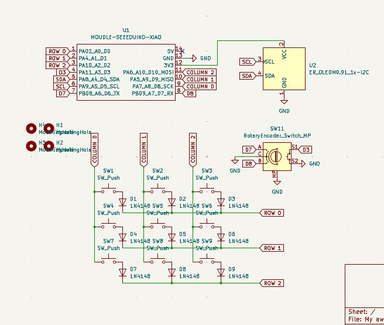
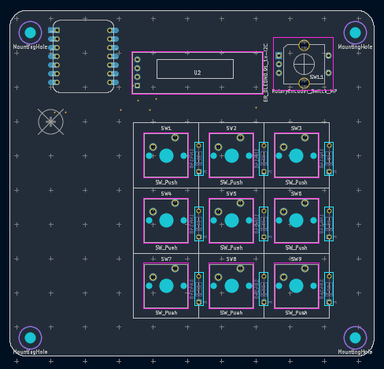

# Macropad-Hackclub
A 3 by 3 macropad keyboard layout with a rotary volume knob and a small OLED display mounted on a custom PCB. The display I used is the SD1306 128 by 32  OLED.
## Schematic

## PCB-Design

### ⚠️ Future consideration: 
- May need to change the Micro Controller to an ESP32 Dev kit
- May need to replace the OLED to the 0.6' 128 by 64 version
- May also need to change the keys

> **Note:** WTH everything may need to be replaced except for the knob I hope I may also use prototype pcb instead of a proffesional if I am unable to get the funds

[schematic]:
[pcb]: Images/PCB-design-RP2040.png
